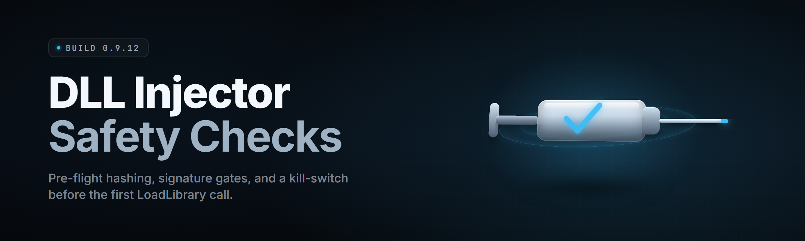

  
  
  

  

  
  
  

---

**A DLL injector with safety checks built in — 2026 edition. Load, verify, inject, roll back. No surprise bricks, no orphaned handles, no mystery crashes.**

---

## 🧩 Overview

`dll-injector-safeguard` is a Windows desktop DLL injector that treats every inject like a surgical procedure: pre-flight target checks, module signature verification, handle accounting, and automatic rollback if the injected DLL faults the host process. Built for modders, reverse engineers, and red-teamers who got tired of losing a session to a half-written payload.

| Category | Details |
|---|---|
| Distribution | Single portable `.exe`, no installer, no runtime deps |
| Injection methods | `CreateRemoteThread`, `NtCreateThreadEx`, `QueueUserAPC`, manual map |
| Safety layer | Pre-flight validation, post-inject watchdog, rollback journal |
| Target classes | Native Win32, Unity, Unreal, custom x64 hosts |
| Admin model | Elevation optional; required only for protected targets |

Read the overview, grab the build, extract, run the `.exe`. The safety checks fire automatically — you don't configure them, you just watch them hold.

## 📦 Download

  

---

## 📖 Table of Contents

- [What is a DLL injector with safety checks](#-what-is-a-dll-injector-with-safety-checks)
- [The Problem](#-the-problem)
- [The Solution](#-the-solution)
- [Key Features](#-key-features)
- [Quick Start](#-quick-start)
- [Grouped module catalog](#-grouped-module-catalog)
- [Comparison](#-comparison)
- [Installation](#-installation)
- [System Requirements](#-system-requirements)
- [All modules status](#-all-modules-status)
- [Tips for best results](#-tips-for-best-results)
- [Compatibility / platform support](#-compatibility--platform-support)
- [Usage guidelines](#-usage-guidelines)
- [Known Issues](#-known-issues)
- [FAQ](#-faq)

---

## 🔍 What is a DLL injector with safety checks

A DLL injector loads an external DLL into a running process's address space so its code executes inside that process. A *safe* injector adds a guard layer around that operation: it refuses to inject into targets that can't survive it, verifies what it's about to load, and knows how to undo the injection cleanly if the payload misbehaves.

| Term | Explanation |
|---|---|
| Target process | The running `.exe` you're injecting into; identified by PID or window title |
| Payload | The `.dll` file being loaded into the target's address space |
| Handle journal | A per-inject ledger of every kernel handle opened, so nothing leaks on rollback |
| Pre-flight check | Validation pass run *before* the write: arch match, ASLR region, writable pages |
| Watchdog | Post-inject thread that samples target health and triggers rollback on fault |
| Manual map | Loading a DLL without `LoadLibrary`, avoiding the loader lock and module list |
| Rollback journal | On-disk record of the injection so a bad load can be reversed |

Core benefits:

- **Fail-safe by default** — a bad inject becomes a no-op, not a crashed host.
- **Handle-clean** — every `OpenProcess`/`VirtualAllocEx` is tracked and freed.
- **Architecture-aware** — blocks the classic x86-into-x64 crash before it happens.
- **Auditable** — every action written to a local log you can read.

---

## 🩹 The Problem

- You inject a payload, the target hangs, and you lose twenty minutes of unsaved state.
- A half-loaded DLL leaves the host in a zombie state — window frozen, no crash dialog, no recovery.
- Handles leak across repeated injects until the process hits its object-limit and dies.
- Wrong-architecture payloads crash the target instantly with no useful error.
- No injector tells you *what* it's about to do before it does it.
- Rollback is manual, error-prone, and usually means "restart the app and hope."
- Anti-cheat and integrity layers flag naive injectors because they leave obvious footprints behind.

## 🛠️ The Solution

| Problem | Solution |
|---|---|
| Host hangs on bad inject | Watchdog samples health and rolls back within ~250ms |
| Zombie half-loaded state | Journaled unload restores module list and thread state |
| Handle leaks | Handle journal frees every kernel object on exit |
| Arch mismatch crash | Pre-flight arch check blocks the inject before any write |
| Blind injects | Dry-run mode prints the full plan without touching the target |
| Manual rollback | One-click rollback replays the journal in reverse |
| Obvious footprint | Stealth loader path avoids the standard module list where legal |

---

## ⚙️ Key Features

| Feature | Description | Benefit |
|---|---|---|
| Pre-flight validation | Arch, page perms, ASLR, target state checked first | Blocks doomed injects |
| Dry-run planner | Prints exact memory plan, no writes | See before you do |
| Handle journal | Tracks every opened kernel handle | Zero leaks |
| Post-inject watchdog | Health polling with auto-rollback | Survives bad payloads |
| Rollback journal | Reversible injection record | Clean undo |
| Multi-method inject | CRT, NtCreateThreadEx, APC, manual map | Pick the right tool |
| Signature check | Optional Authenticode verify on payload | Load only trusted DLLs |
| Session profiles | Save target + method + payload presets | Repeatable workflows |
| Live log viewer | In-app action log | Debug fast |
| Batch queue | Inject multiple payloads in sequence | Power-user flow |
| CLI mode | Headless inject for scripts | Automation-ready |
| Restore point | Snapshots target module state pre-inject | One-click recovery |

---

## 🚀 Quick Start

1. 🧲 **Download** the portable `.exe` and drop it in any folder — no install needed.
2. 📂 **Extract** the archive; you'll see the `.exe` and a `config` folder.
3. 🎯 **Launch** the `.exe`, pick a target process from the live list.
4. 🧪 **Dry-run** first — hit *Plan* to see the full memory layout the injector intends to write.
5. 💉 **Inject** — choose a method, load your payload DLL, and watch the safety log confirm each step.

---

## 🧱 Grouped module catalog

### 🎯 **Target Discovery & Validation**
- **Process Lister** — enumerates PIDs with arch, elevation, and protection flags.
- **Window Matcher** — resolve target by window title or class name.
- **Arch Guard** — refuses cross-architecture injects before any write.
- **Protection Probe** — detects protected-process status and warns early.
- **State Snapshotter** — captures module list + thread count pre-inject.

### 💉 **Injection Engines**
- **CRT Engine** — classic `CreateRemoteThread` with `LoadLibraryW` path.
- **Nt Engine** — `NtCreateThreadEx` variant for hosts that block CRT.
- **APC Engine** — `QueueUserAPC` delivery for thread-hijack scenarios.
- **Manual Mapper** — reflective load with manual relocation and import fixup.
- **SetWindowsHook Engine** — message-loop based delivery for GUI targets.

### 🛡️ **Safety & Rollback**
- **Pre-flight Validator** — full plan check before any byte is written.
- **Handle Journal** — ledger of every kernel handle, freed on exit.
- **Watchdog Thread** — health sampler with configurable fault threshold.
- **Rollback Journal** — on-disk reversal record, replayable in reverse.
- **Restore Point** — snapshot of target module state for one-click recovery.
- **Fault Isolator** — catches first-chance exceptions from the payload.

### 🔐 **Payload Integrity**
- **Signature Checker** — optional Authenticode verification on the DLL.
- **Hash Pinner** — pin payload to a known SHA-256 before load.
- **Arch Verifier** — confirms payload PE header matches target arch.
- **Import Scanner** — warns if payload imports APIs the target can't resolve.
- **Size Sanity** — rejects absurdly large or zero-byte payloads.

### 📋 **Workflow & Tooling**
- **Session Profiles** — save/load target+method+payload presets.
- **Batch Queue** — sequence multiple injects with per-step rollback.
- **CLI Runner** — headless mode for scripted workflows.
- **Live Log Viewer** — timestamped action stream in-app.
- **Export Report** — dump the session log to a text file.
- **Config Editor** — tweak thresholds without editing files by hand.

### 🧠 **Diagnostics**
- **Memory Map Viewer** — shows target's writable/executable regions.
- **Handle Inspector** — lists handles the injector currently holds.
- **Timing Profiler** — measures each inject phase in milliseconds.
- **Crash Digest** — summarizes why a rollback fired.
- **Version Reporter** — prints injector + target build info.

---

## ⚖️ Comparison

| Aspect | Alternative | This Tool |
|---|---|---|
| Pre-inject validation | None, or minimal | Full plan with dry-run |
| Rollback | Manual restart | Journaled, one-click |
| Handle cleanup | Often leaks | Journaled, always freed |
| Arch mismatch | Crashes target | Blocked pre-write |
| Payload verification | None | Signature + hash pin |
| Method choice | Usually one | Five engines |
| Automation | GUI only | CLI + batch queue |
| Logging | Ad-hoc | Timestamped, exportable |

---

## 💾 Installation

1. **Get the file.** Download the archive from the project page; it contains the `.exe` and a `config` folder.
2. **Extract.** Right-click → *Extract All* to any folder you own (avoid `Program Files` to skip UAC prompts on config writes).
3. **Run.** Double-click the `.exe`. First launch writes a default `config/settings.ini`. Elevate only if you're targeting a protected process.

> Safety checks run on every inject regardless of config. You can tune thresholds, not disable the guard layer.

---

## 🖥️ System Requirements

| Component | Minimum | Recommended |
|---|---|---|
| OS | Windows 10 1809 x64 | Windows 11 23H2 x64 |
| CPU | Dual-core 2.0 GHz | Quad-core 3.0 GHz+ |
| RAM | 4 GB | 16 GB |
| Storage | 200 MB free | 1 GB free (logs + journals) |
| Runtime | None (portable) | None (portable) |
| Privileges | User (own processes) | Admin (protected targets) |

---

## ✅ All modules status

| Module | Status | Description |
|---|---|---|
| Process Lister | ✅ Working | Enumerates targets with arch + protection flags |
| Arch Guard | ✅ Working | Blocks cross-arch injects pre-write |
| Pre-flight Validator | ✅ Working | Full memory-plan validation |
| Handle Journal | ✅ Working | Tracks and frees every kernel handle |
| Watchdog Thread | ✅ Working | Health sampling + auto-rollback |
| Rollback Journal | ✅ Working | Reversible injection record |
| CRT Engine | ✅ Working | `CreateRemoteThread` inject path |
| Nt Engine | ✅ Working | `NtCreateThreadEx` inject path |
| APC Engine | ✅ Working | `QueueUserAPC` delivery |
| Manual Mapper | ✅ Working | Reflective load with relocation |
| Signature Checker | ✅ Working | Optional Authenticode verify |
| Hash Pinner | ✅ Working | SHA-256 payload pinning |
| Batch Queue | ✅ Working | Sequential injects with rollback |
| CLI Runner | ✅ Working | Headless scripted mode |
| Memory Map Viewer | ✅ Working | Writable/executable region display |
| Crash Digest | ⚠️ Beta | Summarizes rollback causes |
| SetWindowsHook Engine | ⚠️ Beta | GUI message-loop delivery |
| Import Scanner | ✅ Working | Unresolved-import warnings |

---

## 🎯 Tips for best results

- Always **dry-run first** on a fresh target — the plan is free, the crash isn't.
- Pin your payload with a **SHA-256 hash** in the profile; the injector will refuse a swapped DLL.
- Keep `config/journals/` on a fast drive — rollback replay latency scales with journal I/O.
- Run the injector **at the same integrity level** as the target to avoid silent handle failures.
- Use **Manual Map** only when you understand relocation; the CRT path is the safe default.
- Enable the **watchdog at 100ms** sampling for latency-sensitive targets, 250ms for the rest.
- Export the **session report** after any rollback — the crash digest usually names the failing import.

---

## 🧮 Compatibility / platform support

| Platform | Support | Notes |
|---|---|---|
| Windows 11 x64 | ✅ Full | Primary target |
| Windows 10 x64 | ✅ Full | 1809+ |
| Windows Server 2022 | ✅ Partial | No GUI targets |
| Windows 10 x86 | ⚠️ Limited | 32-bit injector build only |
| Wine / Proton | ❌ None | Kernel calls unsupported |
| Protected processes | ⚠️ Blocked | Guard refuses by design |

---

## 📜 Usage guidelines

| Allowed | Not allowed |
|---|---|
| Modding single-player games you own | Injecting into processes you don't control |
| Reverse-engineering your own binaries | Bypassing protections on third-party software without permission |
| Red-team engagements with written scope | Any use against systems you lack authorization for |
| Debugging your own DLLs in a host | Distributing payloads you didn't write and can't verify |

---

## 🐞 Known Issues

| Issue | Solution |
|---|---|
| Watchdog false-positive on Unity targets | Raise threshold to 400ms in profile |
| Manual map fails on CFG-enabled hosts | Use Nt Engine instead |
| Signature check rejects self-signed payloads | Add your cert to trusted store or disable check |
| CLI mode ignores config profiles | Pass `--profile` explicitly |
| Rollback journal grows on long sessions | Set `journal_max_mb` in settings |

---

## ❔ FAQ

**Q:** Does this work on modern anti-cheat protected games?
**A:** The guard layer will detect protected-process status and refuse by default. That's a safety check, not a bypass — it protects your session and the target.

**Q:** Do I need admin rights?
**A:** Only if you're injecting into a process running at a higher integrity level than the injector. For your own apps, plain user works.

**Q:** What happens if my payload crashes the target?
**A:** The watchdog catches the fault and replays the rollback journal, restoring module state within roughly 250ms.

**Q:** Can I disable the safety checks?
**A:** You can tune thresholds and disable optional checks like signature verification. The core guard — arch validation, handle journal, rollback — stays on.

**Q:** Is there a 32-bit build?
**A:** Yes, a limited 32-bit injector ships for 32-bit hosts. It can't inject into 64-bit targets.

**Q:** Where are logs stored?
**A:** Under `config/logs/` next to the `.exe`, one file per session, timestamped.

**Q:** Does it leave handles behind?
**A:** No — the handle journal frees every kernel object opened during the inject, even on rollback.

**Q:** Can I script it?
**A:** Yes — the CLI Runner exposes the same engines headlessly with `--target`, `--payload`, and `--method` flags.

---

## 📝 Changelog

- **v2.4.0** — Added Hash Pinner, Import Scanner, watchdog threshold tuning.
- **v2.3.1** — Fixed handle leak on APC rollback path.
- **v2.3.0** — Manual Mapper relocation rewrite; dry-run planner added.
- **v2.2.0** — Rollback journal, session profiles, CLI Runner.

---

## 📥 Get the build

  

`dll-injector-safeguard` ships as one portable `.exe` because a safety layer you have to install is a safety layer you'll skip. Extract it, run it, dry-run your first inject, and watch the guard hold when a payload misbehaves. The journal is your undo button, the watchdog is your net, and the log tells you exactly what happened. Ship the inject, keep the session, walk away clean.

